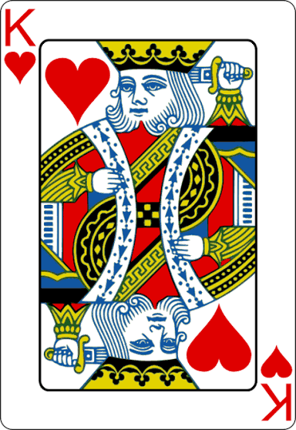

#  MatFyz Blackjack

**Problem Description**: People would like to play the classical game of blackjack without going to a casino
or registering somewhere online and experience the thrill of gambling without losing any money.
The goal of the project is to make a quality blackjack game that doesn't require registration or paying real
money. We will do this by implementing a desktop version of the game using Pygame.

**Problem Formalization**: The application will simulate a single-player Blackjack table against an
automated dealer. The player begins with a set bankroll, say $1000, places a bet using chips, and
receives cards dealt from a multi-deck shoe. The system must track card order, discard used cards and
automatically reshuffle the shoe when cards run out. It must enforce all standard house rules and states:
calculating hand values (counting aces as 1 or 11 depending on the situation), detecting "Blackjack", and
allowing the player to hit, stand, double down, or split identical cards. Once the player finishes their turn,
the dealer acts according to standard casino rules (hitting on 16 or lower). Finally, the game updates the
player's bankroll and saves the history of it in memory.

**Algorithm Design:** The game will be designed turn-based (statuses like idle, betting, dealing, playerTurn,
dealerTurn, payout etc..) and structured cleanly using OOP classes:
- **Card & Shoe**: represents individual cards and manages the shoe, including shuffling and dealing
cards, tracking card order
- **Hand:** stores cards in hand, calculates hand total, and checks for busts or splits
- **Game:** controls the main rules, game loop, turn status, bet payouts, and dealer hit/stand logic
- **UI:** manages Pygame, handles animations, triggers sound effects, and generates the balance
history graph using Matplotlib

**Input/Output Specification:**

**Input:** User interacts via button clicks through the GUI and keyboard shortcuts (selecting chip amounts to
bet, and choosing to hit, stand, double, or split). The program also reads a local JSON file containing the
player's saved bankroll and past balance history, along with game images and assets.

**Output:** Instant changes in the GUI (dealt cards, animations, hand totals, and current balance), audio
sound effects (shuffling, card dealing, winning/losing), a Matplotlib line graph showing bankroll
progression over time, and an updated JSON file written after each round (though not meant for the user).

**Interface Description:** The project will feature a 2D GUI built with Pygame and styled in MatFyz colors
with custom-made cards and table assets. The main screen will display the dealer’s hand at the top, the
player’s hand and active bet at the bottom, as well as the multi-deck shoe on the top right. Interactive
features will include clickable chips for betting, action buttons for hitting, standing etc.. (which also react
to keyboard presses), basic card moving and flipping animations, sound effects, and a button to view the
Matplotlib balance history graph.

